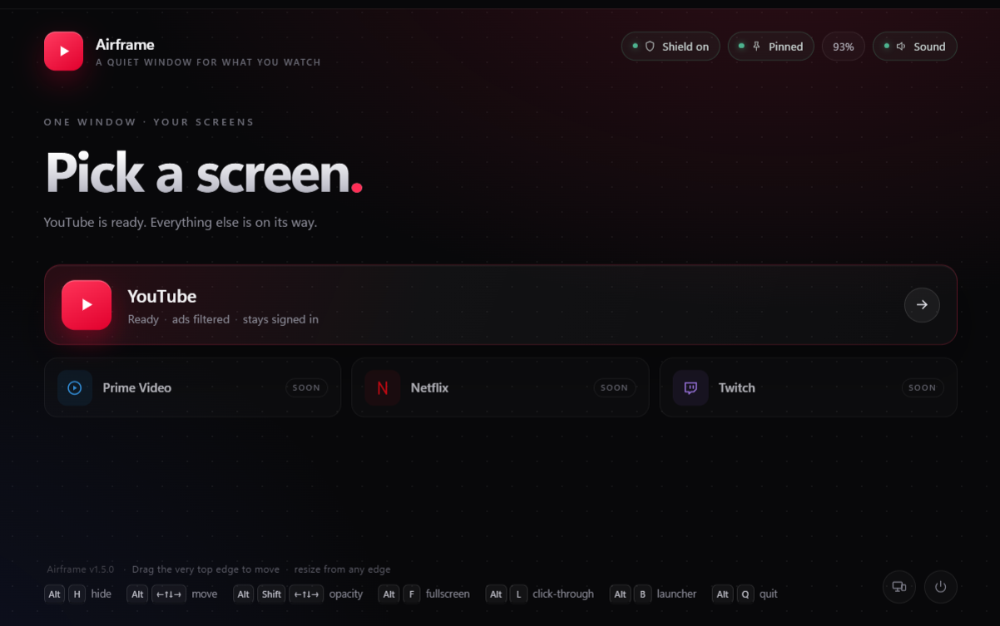

<div align="center">

# Airframe

### Watch while you work.

A quiet, floating YouTube window for Windows that stays on top, fades to any
opacity, lets your clicks pass straight through, and hides itself from screen
share, so you can keep a video going while you code, study, or sit in a meeting.

**[⬇ Download for Windows](https://github.com/poshithNandyala/airframe/releases/latest)** ·
[Report a bug / ask for a feature](https://github.com/poshithNandyala/airframe/issues)



</div>

---

## Why Airframe

A browser tab disappears behind your work, and picture-in-picture gives you a
tiny box with no controls. Airframe is a real YouTube window that behaves like
part of your desktop:

- 🪟 **Floats on top, with no title bar, taskbar button or tray icon.** It looks
  like a screen, not an app.
- 🌫️ **Any opacity, 0–100%.** Fade it until it's just a hint over your editor.
- 👻 **Click-through mode.** Press `Alt+L` and every click, scroll and drag
  goes to the app *behind* the video. Keep watching, keep working.
- 🛡️ **Hidden from screen share.** Teams, Zoom, Meet, OBS and screenshots see
  nothing (on by default).
- ⌨️ **Works from anywhere.** Global `Alt` shortcuts control it while you type
  in another app, and they never open that app's menus.
- 👆 **Touchpad swipe back/forward**, like Chrome: two fingers right takes you
  from a video back to your search results.
- 🚫 **Fewer ads.** Ad and tracker requests are blocked and in-player ads are
  skipped.
- 🔒 **Private.** No account, no telemetry, no server. Your YouTube sign-in
  stays on your PC.

---

## Install

1. Go to **[Releases](https://github.com/poshithNandyala/airframe/releases/latest)**
   and download `Airframe-<version>-win-x64.zip`.
2. Unzip it anywhere (for example `C:\Apps\Airframe`).
3. Run **`Airframe.exe`**.

The app is not code-signed yet, so Windows SmartScreen may say *"Windows
protected your PC"* the first time. Click **More info → Run anyway**.

> Tip: right-click `Airframe.exe` → **Send to → Desktop (create shortcut)**.

---

## How to use it

1. **Open Airframe.** A small launcher appears in the middle of your screen at 93%
   opacity.
2. **Click YouTube.** Sign in once if you like; the session is remembered.
3. **Put it where you want it.** Drag the thin strip at the very top, or hold
   `Alt` + arrow keys to glide it. Resize from any edge.
4. **Fade it.** Hold `Alt+Shift` and press ↑/→ for more visible, ↓/← for less.
5. **Work through it.** Press `Alt+L`. The video keeps playing while your mouse
   controls the app underneath. Press `Alt+L` again to take the window back.
6. **Hide it instantly.** Press `Alt+H`. Press it again to bring it back.

### Keyboard shortcuts

These work everywhere, even while another app has focus.

| Keys | What it does |
|---|---|
| `Alt+H` | Hide / show |
| `Alt+←` `→` `↑` `↓` | Move the window (hold to glide) |
| `Alt+Shift+↑` / `→` | More visible (+opacity) |
| `Alt+Shift+↓` / `←` | Less visible (−opacity) |
| `Alt+L` (or `Ctrl+Alt+L`) | Click-through on / off |
| `Alt+F` (or `Alt+Enter`) | Fullscreen on / off |
| `Alt+M` | Mute / unmute |
| `Alt+S` | Screen-share shield on / off |
| `Alt+T` | Always on top on / off |
| `Alt+R` | Reload YouTube |
| `Alt+B` (or `Alt+Home`) | Back to the launcher (pauses the video) |
| `Alt+Shift+D` | Move to the next monitor, or recenter if it's off-screen |
| `Alt+Q` | Quit |

### Touchpad and mouse

| Gesture | What it does |
|---|---|
| Two fingers **right** | Back (video → your search results) |
| Two fingers **left** | Forward |
| Mouse side buttons | Back / forward |

While you swipe, a small arrow slides in from the edge. It turns white when
letting go will navigate. Swipe back before letting go to cancel.

---

## Good to know

- **Click-through targets the window behind Airframe.** Bring the app you want
  to use to the front (click its taskbar icon), then press `Alt+L`.
- **At 0% opacity** the window is invisible and lets clicks through, so it can't
  get in your way. `Alt+Shift+↑` brings it back.
- **Lost the window?** `Alt+Shift+D` recenters it. Launching Airframe again
  also brings the running copy back.
- **Remembered between launches:** position, size, always-on-top and the
  shield. Opacity starts at 93% every time; click-through always starts off.
- **Sign-in** is stored in `%APPDATA%\Airframe`.
- **Limits:** Windows 10/11 only. Rented movies and other DRM-only videos won't
  play (Electron does not ship Widevine). YouTube changes its ads often, so a
  brand-new ad format may slip through until the filter is updated.
- **Coming soon:** Prime Video, Netflix and Twitch screens.

---

## Found a bug? Want a feature?

Open an issue → **[github.com/poshithNandyala/airframe/issues](https://github.com/poshithNandyala/airframe/issues)**

Bug reports, ideas and "it would be great if…" requests are all welcome. For
bugs, include your Windows version and what you pressed. The log at
`%APPDATA%\Airframe\airframe.log` helps too.

If Airframe makes your workday better, a ⭐ on the repo helps other people find
it.

---

## Build from source

Requires Windows, [Node.js](https://nodejs.org/) 20+ and the .NET Framework 4
C# compiler (already on Windows 10/11).

```powershell
git clone https://github.com/poshithNandyala/airframe.git
cd airframe
npm install
npm start        # builds the hotkey helper, then runs the app
npm run dist     # packages dist\Airframe-win32-x64\Airframe.exe
```

| Path | What's inside |
|---|---|
| `main.js` | Window, launcher/YouTube views, hotkeys, ad filter, swipe navigation |
| `preload-content.js` | Runs in YouTube: ad skipper, cosmetic filter, toasts, swipe arrow |
| `preload-ui.js`, `ui/` | Launcher page |
| `helper/AltHotkeys.cs` | Tiny Win32 helper for global `Alt` shortcuts |
| `scripts/` | Build scripts |

### How the Alt shortcuts work

A small helper (`AltHotkeys.exe`) installs a low-level keyboard hook. When you
press `Alt`, it holds the key back until the next key shows what you meant:

- An Airframe shortcut is handled, and the app you're typing in never sees `Alt`
  at all. No menu bar pops up and nothing gets stuck.
- Any other key (`Alt+Tab`, `Alt+F4`, `Alt+E`…) is passed to your app with
  `Alt`, exactly as you typed it.
- `Alt` on its own is passed through as a normal tap, so menus still work.

The helper has no network access and exits with the app.

---

<div align="center">

Made by [Poshith Nandyala](https://github.com/poshithNandyala) · MIT License

</div>
